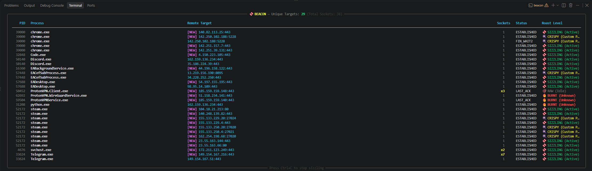
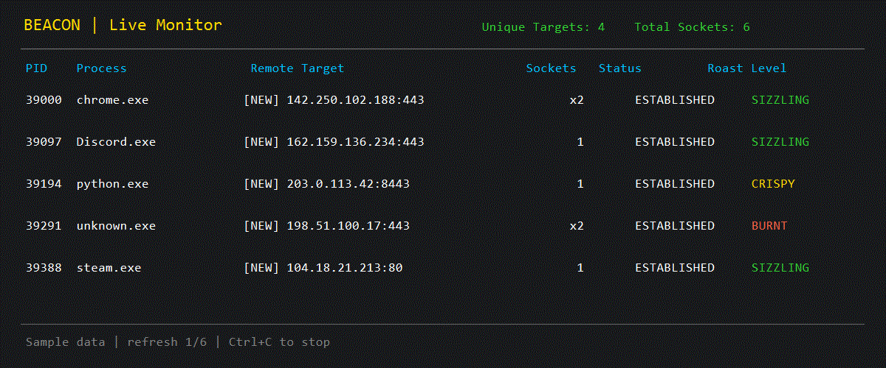
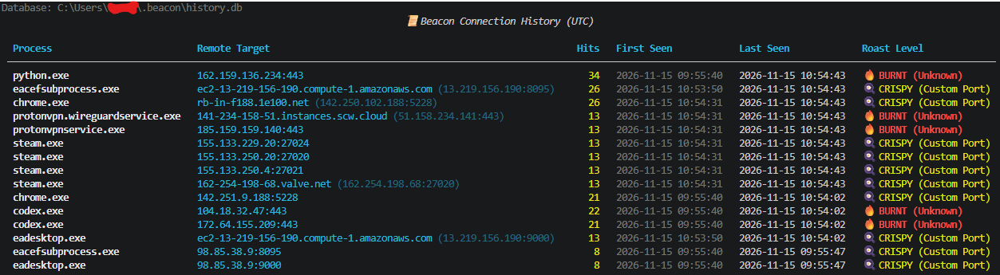

# 🥓 Beacon

[](https://github.com/y-lebid/beacon-net/actions/workflows/ci.yml)
[](https://github.com/y-lebid/beacon-net/releases)
[](./LICENSE)
[](https://github.com/y-lebid/beacon-net/stargazers)
[](https://github.com/y-lebid/beacon-net/issues/new)
[](https://send.monobank.ua/jar/9pR25PQ1MV)

Beacon is a terminal dashboard for seeing which processes connect to public internet hosts. Install with `pip install beacon-net` or download a verified binary from [GitHub Releases](https://github.com/y-lebid/beacon-net/releases/latest).



*Beacon v1.1.0 live monitor: 29 unique targets and their process, remote address, socket state, and roast level.*



*Six-second illustrative demo using sample data; rows and socket counts change on each one-second refresh.*

## Features

- Live IPv4/IPv6 connection monitoring, refreshed once per second by default.
- Public-IP filtering, socket grouping, and background reverse DNS.
- Process trust list with four roast levels: `RAW`, `SIZZLING`, `CRISPY`, and `BURNT` ([classification details](docs/roast-levels.md)).
- Local SQLite history with new-target markers and suspicious-record filters.
- Local data protections, including POSIX file permissions and symlink checks.

History is local to the user account. The observation count is accumulated from socket counts on each scan; it is not a count of distinct TCP sessions. See [Security and data storage](#security-and-data-storage) for access and permission limits.

## Install

### Prebuilt binaries (no Python required)

Download the matching binary and `SHA256SUMS.txt` from [GitHub Releases](https://github.com/y-lebid/beacon-net/releases/latest):

- Windows x64: `beacon-windows-x64.exe` and `beacon.bat`.
- Windows ARM64: `beacon-windows-arm64.exe` and `beacon.bat`.
- Linux x64/ARM64: the matching `.tar.gz` archive.

If you downloaded every release asset, verify them from that directory with:

```bash
sha256sum -c SHA256SUMS.txt
```

On Windows, compare the executable's hash in PowerShell:

```powershell
Get-FileHash .\beacon-windows-x64.exe -Algorithm SHA256
```

Compare the reported hash with the matching executable entry in `SHA256SUMS.txt` (use the ARM64 filename for an ARM64 build).

Run `beacon.bat` on Windows, or extract the Linux archive and run `./beacon`.

### Install from source (Python 3.10+ required)

```bash
git clone https://github.com/y-lebid/beacon-net.git
cd beacon-net
python -m venv .venv
```

Activate the environment and install Beacon:

```bash
# Linux / macOS
source .venv/bin/activate

# Windows PowerShell
.venv\Scripts\Activate.ps1

pip install -e .
```

## CLI

```text
beacon [-h] [-i INTERVAL] [--trust PROCESS] [--whitelist]
       [--history] [--suspicious] [--limit N]
```

Examples:

```bash
# Start the live monitor (one-second refresh by default)
beacon

# Refresh every two seconds
beacon --interval 2

# Show the whitelist path and trusted process names
beacon --whitelist

# Trust a process name (comparison is case-insensitive)
beacon --trust ProtonVPN.Client.exe

# Show the 30 most recently observed history records
beacon --history

# Show up to 100 suspicious records
beacon --history --suspicious --limit 100
```

`--suspicious` filters history to `BURNT` and `CRISPY` records and is intended to be used with `--history`. `--limit` must be a positive integer and defaults to 30.



### Security and data storage

The whitelist and database are stored under `~/.beacon`. On POSIX systems, Beacon sets the directory permissions to `0700` and the whitelist, database, and existing SQLite sidecar files to `0600`. Whitelist updates use an atomic replacement. Beacon refuses to use the config directory, whitelist, database, or database sidecars when the target itself is a symlink. On Windows, the files use the permissions inherited from the user's account and directory ACLs.

Beacon may need elevated permissions to read sockets owned by protected processes. Without them, those processes can appear as `Restricted (PID …)` and are classified as untrusted until their process name can be read.

## Development and tests

Install development dependencies and run the suite:

```bash
pip install -e ".[dev]"
pytest -v
```

GitHub Actions runs pytest on Python 3.10 through 3.14 and runs Bandit and `pip-audit` on pushes and pull requests targeting `main` or `master`. Pushing a `v*` tag builds Windows x64/ARM64 and Linux x64/ARM64 release artifacts, smoke-tests the binaries, and attaches them with SHA-256 checksums.

## Roadmap

- [x] Live terminal dashboard, socket filtering, grouping, and background DNS
- [x] Persistent whitelist and roast-level classification
- [x] SQLite connection history, new-target marking, suspicious-history filtering, and local data hardening (v1.1.0)
- [ ] Local web dashboard with FastAPI and WebSockets (planned for v2.0.0)
