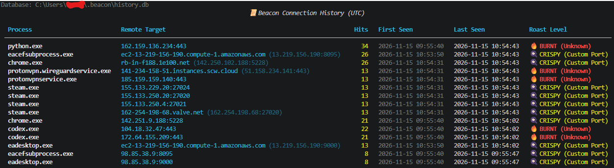

# 🥓 Beacon

[](https://github.com/y-lebid/beacon-net/actions/workflows/ci.yml)
[](https://github.com/y-lebid/beacon-net/releases)
[](./LICENSE)
[](https://github.com/y-lebid/beacon-net/stargazers)
[](https://github.com/y-lebid/beacon-net/issues/new)
[](https://send.monobank.ua/jar/9pR25PQ1MV)

[Read in English](./README.md)

Beacon 1.1.0 — легкий термінальний монітор вихідної мережевої активності. Він показує активні віддалені цілі за процесами, у фоновому режимі визначає доменні імена для IP-адрес і зберігає локальну історію виявлених цілей.


## Можливості

- **Моніторинг у реальному часі:** сканує активні IPv4 та IPv6-сокети через `psutil` і за замовчуванням оновлює Rich-дашборд щосекунди.
- **Фільтрація шуму:** пропускає сокети без віддаленої адреси, сокети `TIME_WAIT` і непублічні IP-адреси: приватні, loopback, link-local та unspecified.
- **Фоновий зворотний DNS:** визначає домени без блокування дашборда. Запити виконуються невеликим пулом потоків, кешуються і мають таймаут три секунди.
- **Групування сокетів:** об'єднує сокети одного процесу, віддаленої IP-адреси, порту й стану в один рядок із лічильником.
- **Список довірених процесів:** зберігається в `~/.beacon/whitelist.json`. Під час першого запуску створюється стандартний список із поширеними настільними та системними процесами (`chronyd`, `MsMpEng.exe` тощо).
- **Захист локальних даних:** whitelist записується атомарно; симлінки для цільових конфігураційних і DB-файлів відхиляються. У POSIX-системах каталог Beacon отримує права `0700`, а файли — `0600`.
- **Рівні «прожарки»:**
  - 🥩 `RAW` — довірений процес на стандартному порту у стані, відмінному від `ESTABLISHED`.
  - 🥓 `SIZZLING` — довірений процес має з'єднання `ESTABLISHED` на порту `80`, `443` або `53`.
  - 🍳 `CRISPY` — довірений процес використовує інший віддалений порт.
  - 🔥 `BURNT` — процесу немає у списку довіри, зокрема якщо Beacon не може визначити його назву.
- **Історія з'єднань:** зберігає процес, віддалені IP-адресу й порт, домен, рівень ризику, час першого й останнього спостереження (UTC) та лічильник спостережень у `~/.beacon/history.db`.
- **Позначка нової цілі:** показує `[NEW]` під час першого запису пари процес/IP/порт. Після DNS-резолвінгу назва хоста оновлюється й надалі не замінюється сирою IP-адресою.
- **Фільтри історії:** перегляд останніх записів, фільтр рівнів `BURNT` і `CRISPY`, а також обмеження кількості рядків.

Історія зберігається локально для поточного користувача. Лічильник накопичує кількість сокетів під час кожного сканування; це не кількість окремих TCP-сеансів.

## Встановлення

### Готові бінарні файли (без встановлення Python)

Завантаж відповідний файл і `SHA256SUMS.txt` зі сторінки [GitHub Releases](https://github.com/y-lebid/beacon-net/releases/latest):

- Windows x64: `beacon-windows-x64.exe` і `beacon.bat`.
- Windows ARM64: `beacon-windows-arm64.exe` і `beacon.bat`.
- Linux x64/ARM64: відповідний `.tar.gz` архів.

Якщо завантажив усі файли релізу, перевір їх у цьому каталозі командою:

```bash
sha256sum -c SHA256SUMS.txt
```

У Windows можна звірити хеш exe через PowerShell:

```powershell
Get-FileHash .\beacon-windows-x64.exe -Algorithm SHA256
```

Звір отриманий хеш із відповідним рядком для exe у `SHA256SUMS.txt` (для ARM64 використовуй назву ARM64-файла).

Запусти `beacon.bat` у Windows або розпакуй Linux-архів і виконай `./beacon`.

### Встановлення з вихідного коду (потрібен Python 3.10+)

```bash
git clone https://github.com/y-lebid/beacon-net.git
cd beacon-net
python -m venv .venv
```

Активуй середовище та встанови Beacon:

```bash
# Linux / macOS
source .venv/bin/activate

# Windows PowerShell
.venv\Scripts\Activate.ps1

pip install -e .
```

## CLI

```text
beacon [-h] [-i INTERVAL] [--trust PROCESS] [--whitelist]
       [--history] [--suspicious] [--limit N]
```

Приклади:

```bash
# Запустити монітор (інтервал за замовчуванням — 1 секунда)
beacon

# Оновлювати дані кожні дві секунди
beacon --interval 2

# Показати шлях до whitelist і довірені процеси
beacon --whitelist

# Додати процес до whitelist (порівняння не залежить від регістру)
beacon --trust ProtonVPN.Client.exe

# Показати 30 найновіших записів історії
beacon --history

# Показати до 100 підозрілих записів
beacon --history --suspicious --limit 100
```

`--suspicious` залишає в історії тільки `BURNT` і `CRISPY` та призначений для використання з `--history`. `--limit` має бути додатним цілим числом; типове значення — 30.



### Безпека та зберігання даних

Whitelist і база розміщуються в `~/.beacon`. У POSIX-системах Beacon встановлює права каталогу `0700`, а whitelist, бази та наявних SQLite sidecar-файлів — `0600`. Оновлення whitelist виконується атомарною заміною. Beacon відмовляється використовувати каталог конфігурації, whitelist, базу або sidecar-файли, якщо сам цільовий шлях є симлінком. У Windows застосовуються права, успадковані від облікового запису користувача й ACL каталогу.

Для перегляду сокетів захищених процесів можуть знадобитися підвищені права. Без них процеси можуть відображатися як `Restricted (PID …)` і вважатися недовіреними, доки Beacon не зможе прочитати їхню назву.

## Розробка й тести

Встанови залежності для розробки та запусти тести:

```bash
pip install -e ".[dev]"
pytest -v
```

GitHub Actions запускає pytest на Python 3.10–3.14, а також Bandit і `pip-audit` для push і pull request у гілки `main` або `master`. Push тегу `v*` збирає Windows x64/ARM64 і Linux x64/ARM64, перевіряє запуск бінарних файлів і додає їх до релізу разом із SHA-256 контрольними сумами.

## Дорожня карта

- [x] Термінальний дашборд, фільтрація і групування сокетів, фоновий DNS
- [x] Постійний whitelist і класифікація рівнів «прожарки»
- [x] Історія з'єднань у SQLite, позначення нових цілей, фільтр підозрілої історії та захист локальних даних (v1.1.0)
- [ ] Локальний вебдашборд на FastAPI та WebSockets (план v2.0.0)
