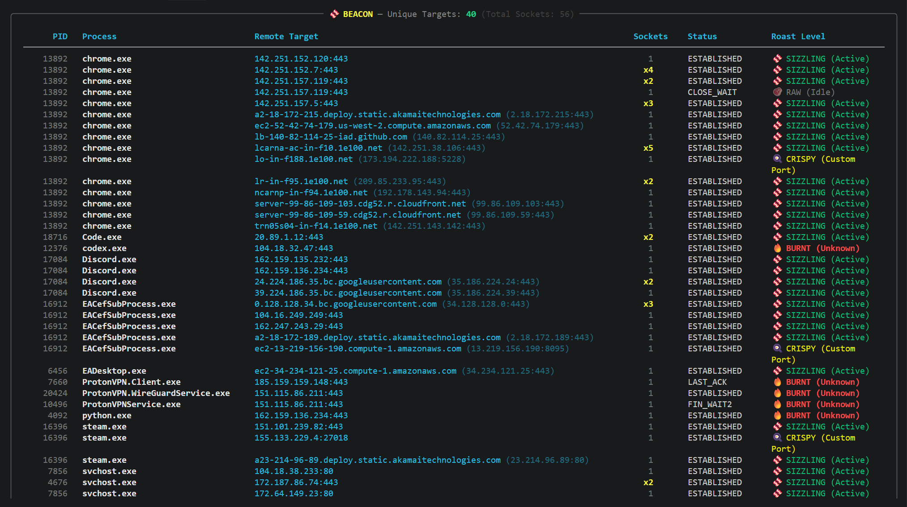

# 🥓 Beacon
[Read in English](./README.md)

Легкий термінальний монітор вихідної мережевої активності процесів у реальному часі, написаний на Python.

Beacon допомагає миттєво побачити, які програми зараз підключаються до інтернету, до яких доменів, IP-адрес і портів вони звертаються, а також оцінити підозрілість кожного з'єднання за допомогою системи рівнів «прожарки».



## Можливості

- **Моніторинг у реальному часі:** перевіряє активні IPv4/IPv6-сокети (`inet`) щосекунди без мерехтіння термінала.
- **Неблокувальний зворотний DNS-пошук:** у фоновому пулі потоків перетворює зовнішні IP-адреси на зрозумілі доменні імена та кешує результати, щоб інтерфейс не зависав.
- **Групування сокетів:** об'єднує кілька з'єднань одного процесу з тією самою ціллю в один рядок із лічильником сокетів (`x2`, `x8`).
- **Фільтрація шуму:** ігнорує loopback-адреси, приватні підмережі (`192.168.x.x`, `10.x.x.x`, `172.16-31.x.x`), link-local-трафік і сокети, що залишилися у стані `TIME_WAIT`.
- **Прив'язка до процесів:** пов'язує кожне з'єднання з програмою, яка його створила, та її `PID`.
- **Система оцінки «Roast Level»:**
  - 🥩 `RAW (Idle)` — довірений процес у стані очікування або закриття з'єднання.
  - 🥓 `SIZZLING (Active)` — активне з'єднання (`ESTABLISHED`) довіреного процесу на стандартному порту (`80`, `443`, `53`).
  - 🍳 `CRISPY (Custom Port)` — довірений процес використовує нестандартний порт.
  - 🔥 `BURNT (Unknown)` — невідомий або недовірений процес звертається до мережі.

## Встановлення та запуск

1. Клонуй репозиторій:
   ```bash
   git clone https://github.com/y-lebid/beacon-net.git
   ```

2. Створи й активуй віртуальне середовище та встанови залежності:
   ```bash
   cd beacon-net
   python -m venv venv

   # Linux / macOS
   source venv/bin/activate

   # Windows
   venv\Scripts\activate

   pip install psutil rich
   ```

3. Запусти монітор:
   ```bash
   python beacon.py
   ```

> Примітка: щоб коректно відображати системні процеси та служби, запускай скрипт із правами адміністратора (`sudo python beacon.py` у Linux або від імені Адміністратора у Windows).
> Без підвищених прав деякі системні процеси можуть відображатися як `Restricted`.

## Roadmap до v1.0.0

- [x] Живий термінальний dashboard (`psutil + rich`)
- [x] Фоновий DNS-резолвінг IP-адрес у доменні імена з кешуванням
- [x] Групування сокетів за назвою процесу
- [ ] Збереження історії з'єднань у SQLite
- [ ] Винесення `TRUSTED_PROCESSES` у зовнішній конфіг-файл та CLI-інтерфейс
